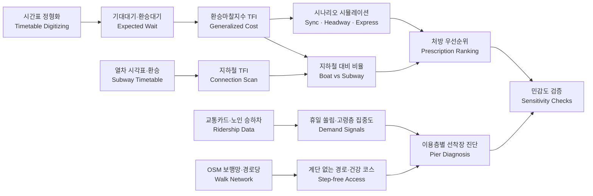
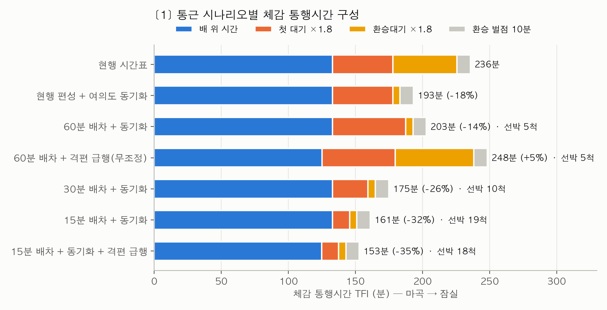
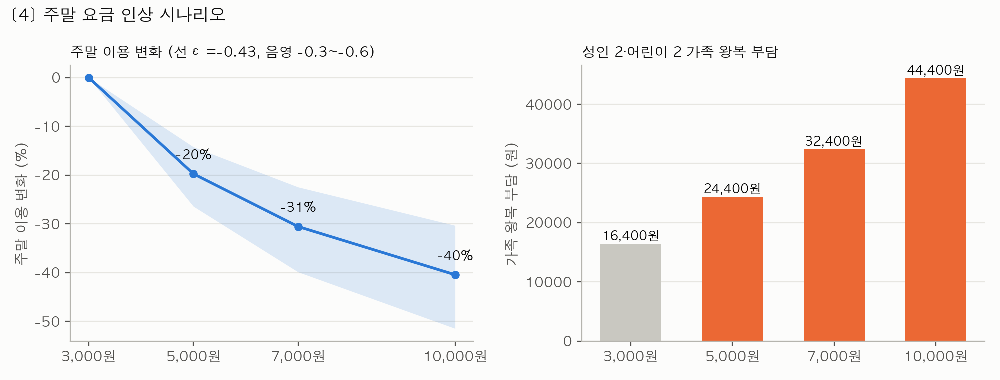

# ⛴️ 속도로 이길 수 없는 대중교통, 누구에게 어떻게 쓰이게 할까

### Diagnosing Demand and Accessibility of a Slow New Transit Mode: The Case of Seoul's Hangang Bus

> 지하철보다 느린 신규 대중교통(한강버스)을 대상으로 대기·환승·도보 부담을 체감 통행시간으로 환산하고, 통근·가족·고령층별 수요와 접근성을 공개 데이터만으로 진단한 데이터 레시피 프로젝트

---

## Overview

본 프로젝트는 **2026 데이터+AI 혁신 챌린지 · 데이터 문제해결 부문(문제해결랩 활용)** 제출작으로, 운항 속도로는 지하철과 경쟁하기 어려운 한강버스가 **누구에게, 어디서, 무엇을 고치면** 일상 교통수단으로 쓰일 수 있는지 분석한 데이터 레시피입니다.

한강버스는 수심 제약으로 약 17km/h 이상 내기 어렵고, 2025년 매출 54억원 중 여객 운송수입은 2억원에 그쳤습니다. 반면 주말 탑승객 비중은 약 51%이고, 선착장 인접역에는 휴일마다 한강을 찾는 수요가 모입니다.

단순히 "한강버스는 느리다"를 확인하는 데서 끝나지 않고,

- 대기·환승·도보 부담을 합친 **체감 통행시간(환승마찰지수, TFI)**
- 같은 출발역·도착역의 **지하철 TFI와의 비교**
- 휴일 가족 수요와 **유아차 접근성**
- 평일 낮 **고령층 이동**과 경로당 출발 **건강 코스 걸음 수**
- 시간표 동기화·배차·급행·요금 **정책 시나리오**

를 함께 분석하여,

> "속도로는 이길 수 없다면, 시간표·환승·접근을 고쳐서 누구의 일상이 될 수 있는가?"

를 데이터로 답하는 것을 목표로 했습니다. 시간표·선착장·인접역만 바꾸면 다른 신규 노선(수상교통, 경전철, 신규 버스노선 등)에 그대로 재사용할 수 있습니다.

---

## Key Features

- 한강버스 누리집 시간표 이미지를 판독해 운항 시간표 160행 정형화
- 무작위 도착 대기 모형으로 선착장별 기대대기·여의도 환승대기 산출
- 국내 환승저항 가중치를 적용한 **환승마찰지수(TFI)** 설계
- 1분 간격 가상 승객 시뮬레이션으로 배차·동기화·급행 9개 시나리오 비교, 필요 선박 수 추정
- 서울교통공사 열차운행시각표(1~9호선) + **Connection Scan 알고리즘**으로 지하철 TFI 계산
- 교통카드 일별 승하차(2026·2025년 1~8월)로 **휴일 쏠림 지수(HCI)** 산출 및 연도 간 재현성 검증
- 서울교통공사 노인 승하차 데이터로 평일 낮 고령층 집중도 분석
- OpenStreetMap(OSMnx) 계단 제외 보행망으로 **계단 없는 경로**와 경로당 출발 건강 코스 계산
- 고정탄력성 수요함수로 처방별 이용 변화·주말 요금 인상 영향 추정
- 가중치·최소 환승시간·보행속도·보폭 민감도 분석

---

## Tech Stack

### Language

<p>
  
  
</p>

### Data Processing & Analysis

<p>
  
  
  
</p>

### Network & Spatial

<p>
  
  
  
</p>

### Modeling & Simulation

<p>
  
  
  
  
  
</p>

### Visualization

<p>
  
</p>

---

## Analysis Framework

### 1️⃣ 체감 통행시간 지표 설계

세 지표를 한 줄로 연결했습니다.

```
운항 시간표 → ① 기대대기·환승대기 → ② 환승마찰지수(TFI) → ③ 수요 반응
             "얼마나 기다리나"      "전체적으로 얼마나 힘든가"  "그래서 얼마나 더(덜) 타나"
```

* **기대대기** = Σ(배차간격²) ÷ (2 × Σ배차간격) = (평균배차 ÷ 2) × (1 + 변동계수²)
* **TFI** = 차내시간 + 1.8 × (첫 대기 + 환승대기) + 10 × 환승횟수 + 도보부담(100m당 2분)
* **수요 반응** = (새 TFI ÷ 현재 TFI)^ε, ε = −0.3 / −0.5 / −0.7 범위로 제시

### 2️⃣ 통근 경쟁력 진단

* 선착장별 기대대기를 TCQSM 배차 등급과 비교
* 여의도 환승대기를 "동기화 이상값(3~5분)"과 "무조정 기대값(약 30분)"과 비교
* 배차(60/30/15분) × 여의도 동기화 × 격편 급행 시나리오 시뮬레이션
* 같은 출발역·도착역의 지하철 TFI와 비교해 통근 대체 가능성 판정

### 3️⃣ 가족 축: 휴일 수요 × 유아차 접근성

* 인접역 (휴일 ÷ 평일 하차) ÷ 서울 전체 비율 = 휴일 쏠림 지수(HCI)
* 자치구 반려견 등록 수와 결합한 가족 수요 점수
* 공식 도보거리, 역 엘리베이터, OSM 계단 없는 경로로 접근 부담 평가
* 주말 요금 인상(3,000원 → 5,000~10,000원) 시 이용·가족 부담 추정

### 4️⃣ 건강 축: 평일 낮 고령층과 건강 코스

* 인접역 평일 10~17시 노인 하차 비중 ÷ 관할역 평균 = 고령층 집중도
* 경로당 → 선착장(계단 없는 경로) → 배 → 공원 산책 코스의 걸음 수
* 하루 6,000~8,000보 목표와 손목닥터9988 걷기 미션 연계

---

## Analysis Workflow



---

## Main Findings

* **선착장 기대대기 26~53분**으로 TCQSM 최하~차하 등급(E~F). 불규칙성 벌점은 1.04~1.12로 작아, 문제는 배차가 들쭉날쭉한 것보다 배차 자체가 긴 것
* **여의도 환승대기**는 마곡→잠실 평균 26분, 잠실→마곡 평균 39분(최대 88분)으로 두 노선 시간표가 서로 맞춰져 있지 않음
* **현재 편성을 그대로 두고 출발 시각만 맞춰도(동기화) 마곡→잠실 체감시간 −18%**. 선박 추가 없이 가능한 가장 비용 효율적인 처방
* **격편 급행만 넣으면 오히려 악화**(마곡→잠실 +5%, 뚝섬→잠실 +20%). 급행은 생활권 이동을 희생하므로 마지막 순서
* 15분 배차는 가장 효과적(−32%)이지만 18~19척이 필요해 현재 12척으로는 불가능. 보유 선박 안에서는 **30분 배차 + 동기화(10척, −26%)**가 최선
* **지하철 대비 체감시간 1.6~4.9배**로 통근 대체는 어려움. 최선 시나리오에서도 장거리는 2.4배지만, 짧은 생활권 구간(뚝섬→잠실)은 **1.3배**로 여가 수요권에 진입
* **휴일 쏠림 지수**는 뚝섬(1.53)·여의도(1.43)가 가장 높고, 2025년 자료로 다시 계산해도 8개 선착장 순위가 동일(Spearman 1.0)
* 공식 인접역 매핑이 결과를 크게 바꿈(망원: 망원역 1.38 vs 공식 연계역 마포구청역 0.89)
* 뚝섬·여의도는 **유아차 탑승 시범 1순위**, 잠실·압구정은 수요는 높지만 역에서 15~26분 걸어야 해 **접근 경로 개선 우선**
* 선착장 인접역에 **평일 낮 고령층이 이미 몰리는 현상은 없음**(집중도 0.83~1.02) → 건강 축은 새 외출을 만드는 처방이며 경로당 단체 모집이 필수
* 경로당 출발 코스는 공원에서 4.0~4.6km를 더 걸어야 8,000보 달성. 노인보호구역 보행속도(0.8m/s)로는 걷기만 약 108분 → 쉼터와 6,000보 기본 코스 설계 필요
* 처방 순위는 대기 가중치·환승 벌점(6개 조합), 최소 환승시간(2/3/5분) 모두에서 동일

---

## Results

| 통근 시나리오별 체감 통행시간 | 한강버스 vs 지하철 |
| --- | --- |
|  |  |

| 여의도 환승대기 | 휴일 쏠림 지수 |
| --- | --- |
|  |  |

| 가족 축: 수요 × 접근 부담 | 주말 요금 인상 시나리오 |
| --- | --- |
|  |  |

| 평일 낮 고령층 이동 | 경로당 출발 건강 코스 |
| --- | --- |
|  |  |

---

## Project Structure

```bash
.
├── README.md
├── requirements.txt
├── run_all.sh                           # 전체 분석 재현 스크립트
├── .gitignore
│
├── analysis/                            # 분석 스크립트
│   ├── build_timetable.py               # 한강버스 시간표 정형화
│   ├── timetable_metrics.py             # 기대대기·여의도 환승대기
│   ├── sim_core.py                      # 시간표 시뮬레이션 공통 함수
│   ├── scenarios.py                     # 배차·동기화·급행 시나리오 + 가중치 민감도
│   ├── subway_tfi.py                    # 지하철 TFI (Connection Scan)
│   ├── compare_subway.py                # 한강버스 vs 지하철
│   ├── demand_signals.py                # 휴일 쏠림 지수(2026·2025)
│   ├── elderly.py                       # 평일 낮 고령층 집중도
│   ├── access_osm.py                    # 계단 없는 보행 경로(OSM)
│   ├── final_tables.py                  # 선착장 진단표·요금 시나리오
│   ├── kyungrodang_courses.py           # 경로당 출발 건강 코스
│   ├── min_transfer_sensitivity.py      # 최소 환승시간 민감도
│   ├── elderly_speed_sensitivity.py     # 고령층 보행속도 민감도
│   └── figures.py                       # 그래프
│
├── data/                                # 입력 데이터(대용량 원자료는 제외)
│   └── README.md                        # 원자료 출처·파일명 안내
│
├── results/                             # 분석 결과
│   ├── *.csv                            # 결과 테이블
│   └── figures/                         # 결과 그래프
│
└── docs/
    ├── recipe/
    │   ├── 레시피_최종본.md              # 최종 데이터 레시피(포털 제출 양식)
    │   └── archive/                     # 이전 버전
    └── submission/
        ├── data_column.csv              # 포털 업로드용 컬럼 정의
        └── data_sample.csv              # 포털 업로드용 데이터 샘플
```

---

## How to Run

```bash
pip install -r requirements.txt
# data/README.md 안내에 따라 원자료를 data/에 배치한 뒤
./run_all.sh
```

* `access_osm.py`, `kyungrodang_courses.py`는 OpenStreetMap(Overpass API)에 접속하므로 인터넷이 필요합니다. 계산 결과(`data/access_paths.csv`, `results/kyungrodang_courses.csv`)는 저장소에 포함되어 있습니다.
* 모든 스크립트는 프로젝트 루트에서 실행합니다.

---

## Data Sources

* 한강버스 운항 시간표(2026.8.15 적용)·노선도 연계교통 안내 — ㈜한강버스 누리집
* 서울시 지하철호선별 역별 승하차 인원(일 단위, 2025·2026년 1~8월) — 서울 열린데이터광장 OA-12914
* 서울교통공사 역별 일별 시간대별 노인 승하차인원(2024) — 공공데이터포털 15101985
* 서울교통공사 도시철도 열차운행시각표(2026.9.14) — 공공데이터포털 15098251
* 서울교통공사 환승 소요시간·엘리베이터 설치현황 — 열린데이터광장 OA-22521, 공공데이터포털 15044261
* 농림축산검역본부 행정구역별 반려동물등록 개체 수(2022) — 공공데이터포털 15125454
* 서울시 경로당 정보, 전국마을회관및경로당표준데이터 — 열린데이터광장 OA-15052, 공공데이터포털 15114136
* OpenStreetMap 보행 네트워크·선착장 위치(ODbL)

⚠️ 대용량 원자료는 저장소에 포함하지 않았습니다. 재실행을 원하면 `data/README.md`의 파일명과 링크에 맞춰 원자료를 내려받아 배치해야 합니다.

---

## Limitations

- 여의도 도착시각은 시간표에 없어 직전 선착장 출발 + 공식 구간시간으로 추정했으며, 실제 운항기록으로 보정이 필요함
- 최소 환승시간(3분), 환승 통로 도보 가중(1.6배), 보폭(0.65m), 일부 판단선(지하철 대비 1.5배 등)은 레시피 가정이며 민감도와 함께 제시함
- 수요 탄력성은 해외 연구값이므로 이용객 수 예측이 아니라 처방 간 크기 비교에만 사용함
- OSM 보행 경로는 8곳 중 4곳에서 공식 도보거리와 크게 어긋나(한강공원 나들목 연결 누락) 유아차 경로는 현장 확인이 필요함
- 고령층 데이터는 2024년·서울교통공사 관할역 기준이고, 반려견 등록 수는 자치구 단위(2022년)임
- 좌표가 있는 경로당 표준데이터는 서울 12개 구만 제공되어, 건강 코스는 강서구(마곡)·강남구(압구정) 출발만 계산함

---

## Conclusion

본 프로젝트는 한강버스의 이용 저조를 "느려서 안 탄다"가 아니라 **"배 밖에서 너무 오래 기다리고, 갈아타고, 걸어야 해서 안 탄다"**로 다시 정의했습니다.

현행 한강버스의 체감 통행시간 중 절반 이상은 배 위가 아닌 대기·환승·도보에서 생기며, 이 부분은 선박을 늘리지 않고도 시간표 동기화와 첫 배 공백 해소로 줄일 수 있었습니다. 반면 장거리 통근 대체는 어떤 시나리오에서도 어려웠습니다.

따라서 한강버스의 일상화는 통근 속도 경쟁이 아니라, **짧은 생활권 이동 · 휴일 가족 나들이 · 평일 낮 고령층 건강 외출**로 이용층을 넓히는 방향으로 설계해야 합니다.
