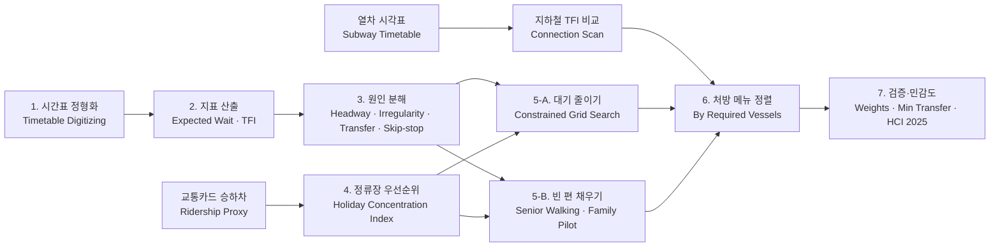
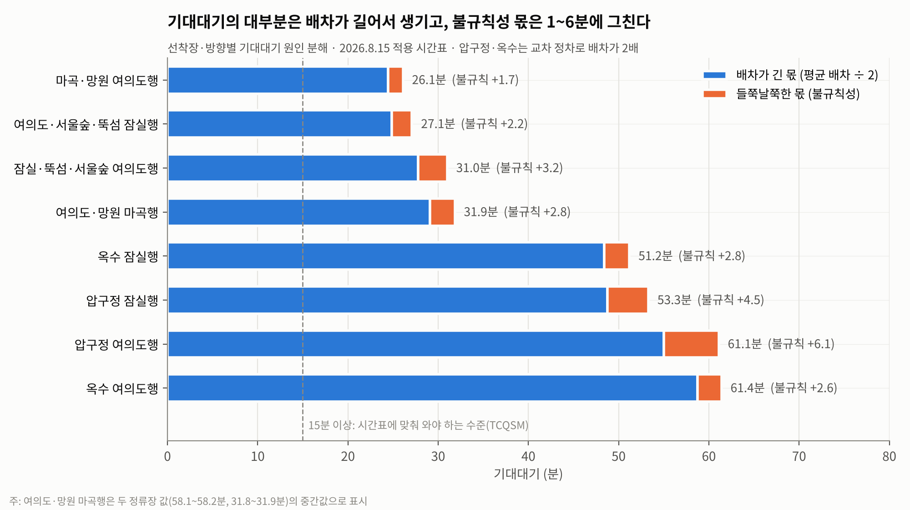
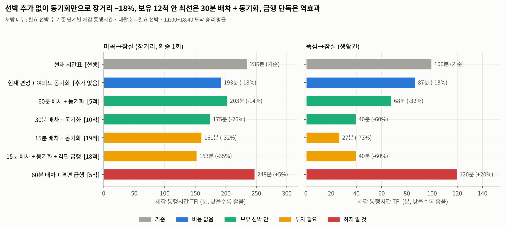
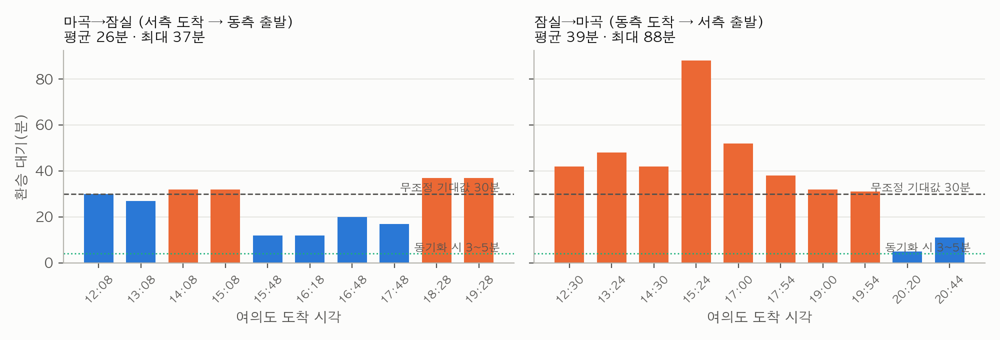
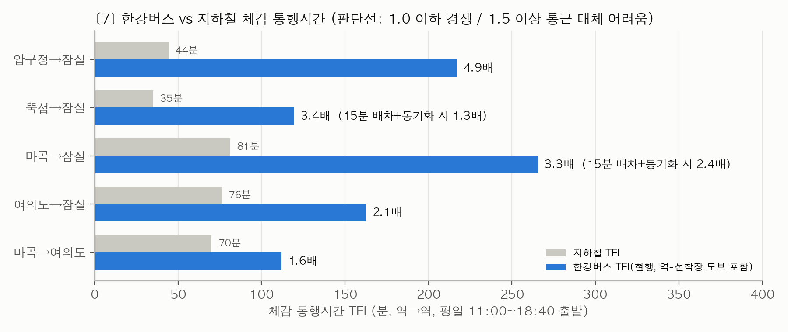
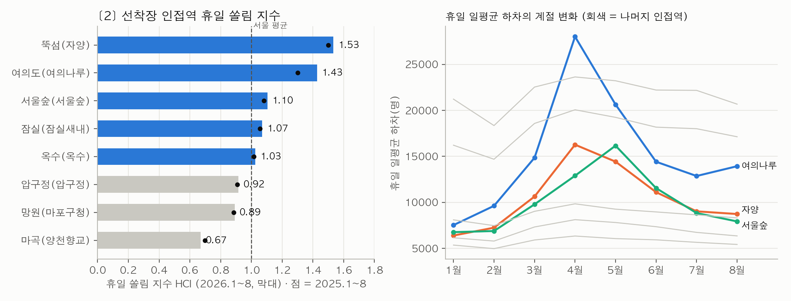
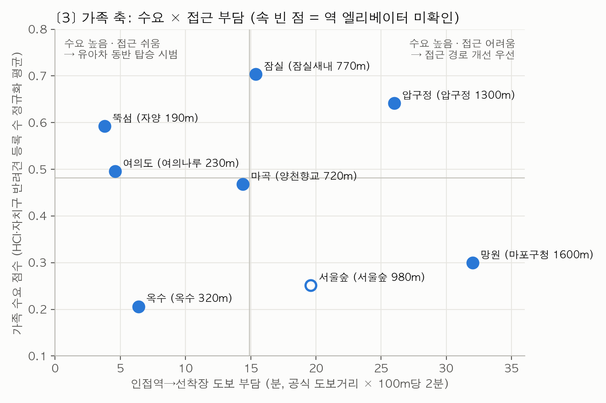
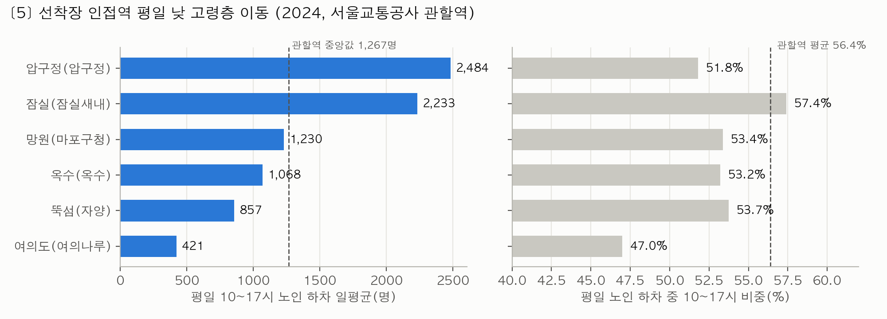
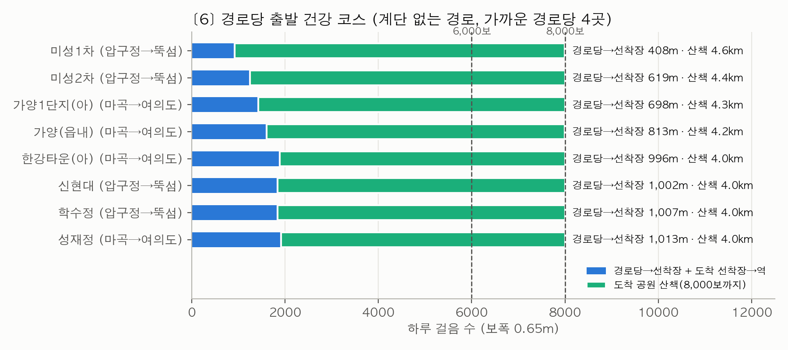

# ⛴️ 승차 데이터 없이 시작하는 저빈도 노선 시간표 처방

### Timetable Prescriptions for Low-Frequency Transit Without Ridership Data: Seoul's Hangang Bus with a 12-Vessel Fleet

> 배차가 길고 차량이 한정된 신규 노선에서, 공개 시간표만으로 대기가 왜 긴지 원인별로 나누고 보유 차량 안에서 비용이 들지 않는 처방부터 순서를 정하는 데이터 레시피

---

## Overview

본 프로젝트는 **2026 데이터+AI 혁신 챌린지 · 데이터 문제해결 부문(데이터레시피 제안)** 제출작입니다.

신규 도입된 대중교통은 기존 수단보다 느리거나 배차가 길어 이용이 저조하고, 이것이 적자와 재정지원 논란으로 이어지는 경우가 많습니다. 사례인 한강버스는 2025년 매출 54억원 중 여객 운송수입이 2억원에 그쳤습니다.

그런데 한강버스의 부담은 배 위가 아니라 **배 밖**에 있습니다. 마곡→잠실 체감 통행시간 265분 중 132분(50%), 뚝섬→잠실 120분 중 106분(88%)이 대기·환승·도보입니다. 그래서 이 레시피는 배 속도가 아니라 **시간표**를 처방 대상으로 삼습니다.

```
① 지표          →  ② 원인 분해          →  ③ 처방 메뉴
얼마나 기다리나     왜 기다리나               무엇부터 고치나
(체감 통행시간)     (배차 길이·불규칙성·      (필요 선박 수 기준:
                    환승 엇갈림·교차 정차·     비용 없음 → 보유 선박 안
                    접근성)                   → 투자 필요 → 하지 말 것)
```

- **필수 입력은 공개 시간표와 보유 차량 수뿐**입니다. 운영사 승하선 실적이 있으면 가중치로 넣어 정밀도를 높이고, 없으면 인접 지하철역 승하차로 대체합니다.
- 시간표·정류장·인접역·보유 차량 수만 바꾸면 농어촌 버스, 수요응답형 셔틀, 신규 수상·순환 노선에 그대로 쓸 수 있습니다.

---

## Key Features

- 누리집 시간표 이미지를 정형화한 운항 시간표(160행) 하나로 전 과정 실행
- 무작위 도착 기대대기 모형으로 대기를 **배차가 긴 몫 / 불규칙한 몫**으로 분해
- 환승 거점(여의도) 환승대기를 무조정 기준선(연결 배차 ÷ 2)과 비교해 시간표 엇갈림 진단
- 국내 환승저항 가중치를 적용한 **체감 통행시간(TFI, 환승마찰지수)**
- **선박 12척 제약 하 시간표 격자 전수탐색**: 노선별 배차 × 환승 출발 오프셋 × 정차 패턴
- 서울교통공사 열차운행시각표 + **Connection Scan 알고리즘**으로 같은 출발역·도착역의 지하철 TFI 계산
- 교통카드 일별 승하차로 **휴일 쏠림 지수(HCI)** 산출, 2025년 자료로 재현성 검증
- 빈 편 채우기: 경로당 출발 건강 코스(걸음 수), 주말 유아차 동반 가족 탑승 시범 대상 선정
- 가중치·최소 환승시간·정류장 가중치·보행속도·보폭 민감도 분석

---

## Tech Stack

### Language

<p>
  
  
</p>

### Data Processing & Analysis

<p>
  
  
  
</p>

### Network & Spatial

<p>
  
  
</p>

### Modeling & Optimization

<p>
  
  
  
  
  
</p>

### Visualization

<p>
  
</p>

---

## Analysis Framework

### 1️⃣ 지표: 얼마나 기다리나

* **기대대기** E[W] = Σh² ÷ (2Σh) = (평균배차 ÷ 2) × (1 + 변동계수²) — 뒤의 항이 불규칙성 벌점
* **환승대기**: 환승 거점 도착 후 최소 환승 3분이 지나고 처음 떠나는 연결편까지의 시간
* **TFI** = 차내시간 + 1.8 × (첫 대기 + 환승대기) + 10 × 환승횟수 + 도보부담

### 2️⃣ 원인 분해: 왜 기다리나

| 진단 신호 | 원인 | 처방 |
| --- | --- | --- |
| 불규칙성 벌점 1.25 이상 | 출발 간격이 들쭉날쭉 | 출발 간격 균등화 |
| 환승대기 ≥ 연결 배차의 절반 | 노선 간 시간표 엇갈림 | 환승 거점 출발 동기화 |
| 정차 편수가 노선 최대의 절반 이하 | 교차(격편) 정차 | 전편 정차 검토 |
| 평균 배차 30분 이상 | 운행 횟수 부족 | 보유 차량 안 증편 |
| 도보 부담이 크고 이용층 조건에서 더 커짐 | 접근성 | 접근 경로 안내·탑승 규정 개선 |
| 특정 시간대 빈 좌석 + 주변 잠재 이용층 | 빈 좌석 | 이용층 연결 코스·시범 |

### 3️⃣ 처방 메뉴: 무엇부터 고치나

* 결정변수: 노선별 배차 h, 환승 거점 출발 오프셋 o, 정차 패턴(교차/전편)
* 목적함수: 정류장 가중치 w(균등 또는 HCI, 실적이 있으면 실적)로 합한 체감 통행시간 최소화
* 제약: Σ⌈왕복시간 ÷ h⌉ ≤ 12척, 운항 11~21시, 최소 환승 3분
* 정렬: 필요 선박 수 기준 비용 없음 → 보유 선박 안 → 투자 필요 → 하지 말 것

---

## Analysis Workflow



---

## Main Findings

* **기대대기 26~61분**(TCQSM E~F등급). 불규칙성 벌점은 1.04~1.12로, 들쭉날쭉해서 더 기다리는 몫은 1.7~6.1분뿐 → 원인은 **배차 자체가 긴 것**
* 압구정·옥수는 **교차 정차**로 하루 5편씩만 서서 배차가 약 100분
* **여의도 환승 엇갈림**: 마곡→잠실 평균 26분, 잠실→마곡 평균 39분(최대 88분)으로 무조정 기준선(약 30분) 수준이거나 그보다 나쁨
* **1순위 처방(비용 없음)**: 동측 잠실행 출발을 서측 여의도 도착 3분 뒤로 → 마곡→잠실 **236분 → 193분(−18%)**
* **보유 선박 안**: 정비·고장 대비 예비선 수에 따라 최선이 달라짐

<details>
<summary><b>예비선 2척(운항 10척): 30분 배차 + 동기화</b></summary>

- 마곡→잠실 236분 → 175분(−26%), 뚝섬→잠실 100분 → 40분(−60%)
- 장거리 구간만 보면 가장 좋은 보유 선박 안
- 압구정·옥수는 교차 정차가 남아 대기가 여전히 50분 안팎

</details>

<details>
<summary><b>예비선 1척(운항 11척): 30분 배차 + 전편 정차 + 동기화</b></summary>

- 압구정·옥수를 매번 들러 두 선착장의 배차가 약 100분 → 30분
- 여의도→잠실 배 위 시간이 7분 늘어 마곡→잠실은 182분(−23%)으로 10척 안보다 조금 불리
- 8개 선착장 전체 가중 체감시간 116분 → 110분 (격자 전수탐색 62개 후보 중 2위, 10척 안은 8위)
- 원인 분해의 "교차 정차 → 전편 정차 검토"가 실제 시간표에서 효과를 내는 안

</details>

<details>
<summary>(참고) 예비선 0척(12척 전부 운항)</summary>

- 25분 배차 + 전편 정차 + 동기화가 1위(가중 체감시간 105분)지만, 고장 시 바로 결항이 생겨 권장하지 않음

</details>

* **하지 말 것**: 격편 급행 단독은 마곡→잠실 +5%, 뚝섬→잠실 +20%로 역효과
* **격자 전수탐색**(12척 제약, 62개 후보): 두 노선 배차가 같을 때 탐색이 고른 환승 오프셋은 모두 **도착 후 3분**으로 동기화 처방을 독립적으로 재확인. 정류장 가중치를 균등 ↔ HCI로 바꿔도 후보 순위 상관 0.998, 상위 6개 동일
* **지하철 대비** 체감시간 1.6~4.9배로 통근 대체는 어렵지만, 15분 배차+동기화 시 짧은 생활권(뚝섬→잠실)은 1.3배로 여가 수요권 진입
* **휴일 쏠림 지수**는 뚝섬 1.53·여의도 1.43이 가장 높고, 2025년 자료로 다시 계산해도 8개 선착장 순위 동일(Spearman 1.0)
* **빈 편 채우기**: 뚝섬·여의도는 유아차 탑승 시범 1순위. 선착장 인접역에 평일 낮 고령층이 이미 몰리지는 않아(집중도 0.83~1.02) 건강 코스는 경로당 단체 모집이 필수
* 처방 순위는 TFI 가중치 6개 조합, 최소 환승시간 2/3/5분 모두에서 동일

---

## Results

| 원인 분해: 배차 길이 vs 불규칙성 | 처방 메뉴: 필요 선박 수 기준 |
| --- | --- |
|  |  |

| 여의도 환승대기 | 한강버스 vs 지하철 |
| --- | --- |
|  |  |

| 정류장 우선순위: 휴일 쏠림 지수 | 빈 편 채우기: 가족 수요 × 접근 부담 |
| --- | --- |
|  |  |

| 평일 낮 고령층 이동 | 경로당 출발 건강 코스 |
| --- | --- |
|  |  |

---

## Project Structure

```bash
.
├── README.md
├── requirements.txt
├── run_all.sh                           # 전체 분석 재현 스크립트
├── .gitignore
│
├── analysis/                            # 분석 스크립트
│   ├── build_timetable.py               # 1. 시간표 정형화
│   ├── timetable_metrics.py             # 2. 기대대기·환승대기
│   ├── diagnosis.py                     # 3. 원인 분해(배차 몫·불규칙 몫·교차 정차)
│   ├── demand_signals.py                # 4. 휴일 쏠림 지수(2026·2025)
│   ├── sim_core.py                      # 시간표 시뮬레이션 공통 함수
│   ├── scenarios.py                     # 5-A. 처방 시나리오 + TFI 가중치 민감도
│   ├── optimize_timetable.py            # 5-A. 12척 제약 격자 전수탐색 + 정류장 가중치 민감도
│   ├── elderly.py                       # 5-B. 평일 낮 고령층 집중도
│   ├── kyungrodang_courses.py           # 5-B. 경로당 출발 건강 코스
│   ├── final_tables.py                  # 선착장 진단표·가족 수요 점수·요금 시나리오
│   ├── subway_tfi.py                    # 지하철 TFI (Connection Scan)
│   ├── compare_subway.py                # 한강버스 vs 지하철
│   ├── min_transfer_sensitivity.py      # 7. 최소 환승시간 민감도
│   ├── elderly_speed_sensitivity.py     # 7. 고령층 보행속도 민감도
│   ├── access_osm.py                    # 부록 C-1. 계단 없는 보행 경로(OSM)
│   └── figures.py                       # 그래프
│
├── data/                                # 입력 데이터(대용량 원자료는 제외)
│   └── README.md                        # 원자료 출처·파일명 안내
│
├── results/                             # 분석 결과 테이블(csv)
│   └── figures/                         # 결과 그래프
│
└── docs/
    ├── recipe/
    │   ├── 레시피_최종본.md              # 최종 데이터 레시피(포털 제출 양식)
    │   └── archive/                     # 이전 버전
    └── submission/
        ├── data_column.csv              # 포털 업로드용 컬럼 정의
        └── data_sample.csv              # 포털 업로드용 선착장 진단 테이블
```

---

## How to Run

```bash
pip install -r requirements.txt
# data/README.md 안내에 따라 원자료를 data/에 배치한 뒤
./run_all.sh
```

* 모든 스크립트는 프로젝트 루트에서 실행합니다.
* `access_osm.py`, `kyungrodang_courses.py`는 OpenStreetMap(Overpass API)에 접속하므로 인터넷이 필요합니다. 계산 결과는 저장소에 포함되어 있습니다.

---

## Data Sources

| 등급 | 데이터 | 출처 |
| --- | --- | --- |
| 필수 | 한강버스 운항 시간표(2026.8.15)·노선도 구간시간·공식 인접역 | ㈜한강버스 누리집 |
| 필수 | 보유 선박 수(12척) | 서울시 발표 |
| 권장 | 지하철호선별 역별 승하차 인원(일 단위) | 서울 열린데이터광장 OA-12914 |
| 권장 | 도시철도 열차운행시각표(1~9호선) | 공공데이터포털 15098251 |
| 권장 | 환승 소요시간, 엘리베이터 설치현황 | 서울교통공사 (OA-22521, 15044261) |
| 권장 | 역별 시간대별 노인 승하차 | 공공데이터포털 15101985 |
| 권장 | 경로당 정보, 전국마을회관및경로당표준데이터 | OA-15052, 15114136 |
| 선택 | 정류장·편별 승하선 실적 | 운영사 자체 보유 |

⚠️ 대용량 원자료는 저장소에 포함하지 않았습니다. 재실행하려면 `data/README.md`의 파일명과 링크에 맞춰 내려받아 배치해야 합니다.

---

## Limitations

- 결과는 수요를 고정하고 체감대기를 비교하는 모형 안의 최적이며, 운영비용·차량 용량·기상 결항은 반영하지 않음
- 공개 자료에 정류장별 승하선 실적이 없어 인접역 휴일 쏠림 지수를 대리 가중치로 사용함(가중치를 바꿔도 순위 유지 확인)
- 환승 거점 도착시각은 직전 출발 + 공식 구간시간으로 추정함(실제 접안에 따라 1~3분 차이 가능)
- 최소 환승 3분, 대기 1.8배, 환승 10분, 보폭 0.65m, 급행 정차 1회당 5.25분 절감, 환승 통로 도보 1.6배는 가정이며 민감도와 함께 제시함
- 수요 탄력성은 해외 연구값이므로 처방 간 크기 비교에만 사용함
- 고령층 데이터는 2024년·서울교통공사 관할역 기준, 반려견 등록은 2022년 자치구 단위, 경로당 좌표는 서울 12개 구만 제공됨

---

## Conclusion

한강버스의 이용 저조는 "느려서"가 아니라 "**배 밖에서 너무 오래 기다리고, 갈아타고, 걸어야 해서**"입니다. 대기는 들쭉날쭉해서가 아니라 배차가 길고 두 노선 시간표가 서로 엇갈려 있어서 생깁니다.

그래서 처방의 순서는 분명합니다. **선박을 늘리기 전에 여의도 출발 시각부터 맞추고(−18%), 보유 선박 안에서 배차를 줄이고(30분 배차, 예비선 1척이면 전편 정차까지), 급행은 마지막에.** 그리고 빈 편은 장거리 통근이 아니라 휴일 가족과 평일 낮 고령층으로 채웁니다.

이 절차는 승차 실적이 쌓이기 전인 신규 노선 도입 초기부터 공개 시간표와 보유 차량 수만으로 시작할 수 있고, 실적이 쌓이면 가중치를 바꿔 같은 절차를 다시 돌리는 **운항 → 실적 축적 → 가중치 갱신 → 재처방**의 순환으로 이어집니다.
